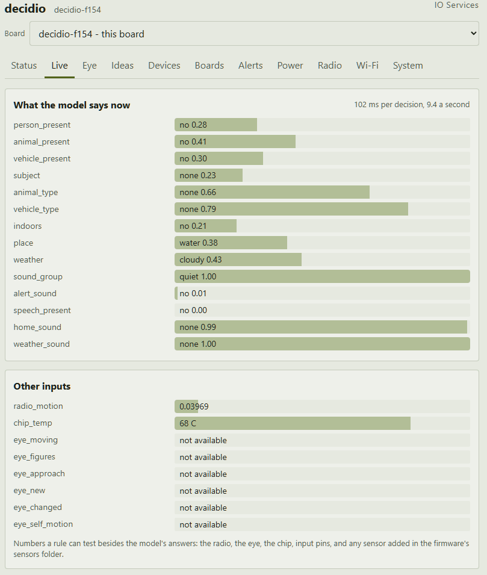
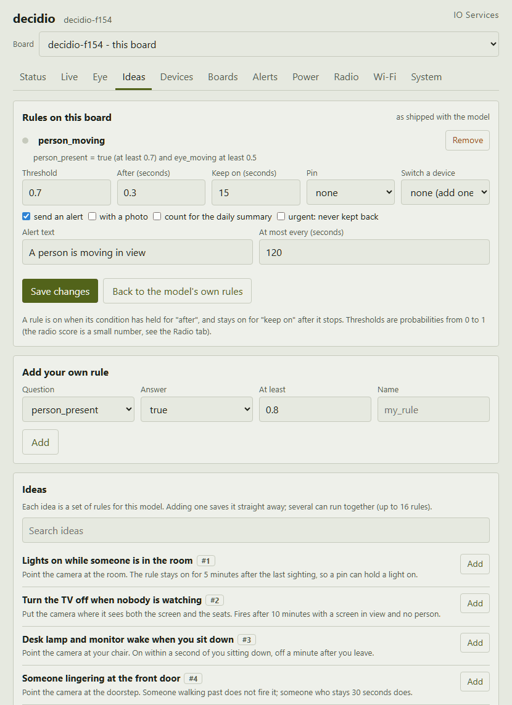
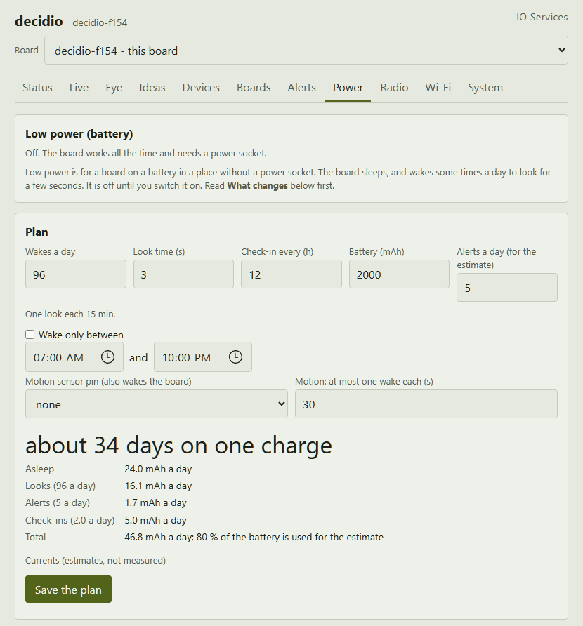

# decidio

decidio puts a small decision model on an ESP32-S3 board. The model examines the camera picture and the sound from
the microphone. It answers fixed questions approximately nine times each second, for example "Is a person in the
room?" or "Was that a knock?". Rules on the board read the answers. A rule can set a pin, write a line to USB, or
send an alert to Telegram, a webhook, MQTT or ntfy.



The picture shows the Live tab of the page of the board. Each line is one question. The bar shows the answer of the
model and how sure the model is, from 0 to 1.

There are 63 ready-made ideas. Each idea is the base model and a set of rules. You install an idea, connect the
board to Wi-Fi, and adjust the idea on the web page of the board. You do not train a model for these ideas.

To install an idea from Chrome or Edge without Python, use the installer website at https://ioserviceslabs.github.io/decidio/.

This file tells you how to install an idea and how to set up the board. These files give more data:

| File | Contents |
|---|---|
| [USE_CASES.md](USE_CASES.md) | The list of ideas, what each idea uses, and the fields of a rule |
| [GUIDE.md](GUIDE.md) | The accuracy of the models, how to teach a new question, how to train a model, the firmware |
| [INSTALL_WITH_LLM.md](INSTALL_WITH_LLM.md) | Instructions for an LLM agent that installs an idea for you |
| [skills/](skills/) | Procedures for an LLM agent: install an idea, add a sensor, add a board, add an idea |

## Necessary equipment

- One of these boards:

  | Board | Camera | Microphone | USB socket to use |
  |---|---|---|---|
  | Seeed XIAO ESP32S3 Sense | Yes | Yes | The USB-C socket |
  | ESP32-S3-CAM (Freenove and equivalent, ESP32-S3-EYE pin layout) | Yes | No | The socket with the label UART |
  | A different ESP32-S3 board with 8 MB of flash memory or more | No | No | The USB socket of the board |

- A USB cable that carries data. A cable that can only charge does not show a port.
- A computer with Windows, Linux or macOS.
- A 2.4 GHz Wi-Fi network, for alerts and for the web page. The board cannot use a 5 GHz network.

The firmware is the same for each board. When the board starts, the firmware finds the camera and the microphone
by itself. You do not tell it which board you have. The Status tab of the page of the board shows what it found.

The firmware is for the ESP32-S3 chip with 8 MB of flash memory or more and PSRAM. A different ESP32-S3 camera
board must have a board profile first. Refer to [skills/add-board](skills/add-board/SKILL.md). The firmware does not
operate on other ESP32 chips (ESP32, ESP32-S2, ESP32-C3, ESP32-C6).

A board does not need a camera. Refer to "A board without a camera".

An idea that uses sound operates only on a board with a microphone. If you install such an idea on a board without a
microphone, the install command stops and tells you. All other ideas operate on each board.

## Quick install

There are three procedures. Each procedure gives the same result. Use one of them. Procedure A is the easiest.

| Procedure | Use it if | Necessary |
|---|---|---|
| A: Install from a browser | You do not want to install Python | Chrome or Edge on a computer |
| B: Install with commands | You can type commands in a terminal | Python 3.10, 3.11 or 3.12 |
| C: Install with an LLM | You have an LLM agent that can run commands on your computer | Python 3.10, 3.11 or 3.12 |

**CAUTION: If you want to keep the software that is on the board now, make a copy of the flash memory before the
install. The install replaces the firmware and the model on the board.**

### Procedure A: Install from a browser

The installer website is at https://ioserviceslabs.github.io/decidio/. It installs an idea through USB with
ESP Web Tools. Python is not necessary.

You must use Chrome or Edge on a computer. A phone cannot do step 3 (**Install**) and step 4 (**Set up**) of the
website.

The website has four numbered steps:

| Step on the website | Function |
|---|---|
| **1. Board** | You select the type of board |
| **2. Idea** | You find one idea and select it |
| **3. Install** | The button **Connect and install** starts ESP Web Tools. It writes the firmware and the idea to the board |
| **4. Set up** | The button **Connect to the board** connects the website to the board through USB (Web Serial). Then you can set the Wi-Fi, the page password and the alerts. Refer to "From the installer website, through USB" |

The types of board at step 1 are:

| Type of board | Select it for |
|---|---|
| Camera and microphone (Seeed XIAO ESP32S3 Sense) | A board with a microphone. This type also operates on a board without a microphone, but the sound questions are off |
| Camera, no microphone (ESP32-S3-CAM, ESP32-S3-EYE pinout) | A board without a microphone |
| Microphone, camera not used (Seeed XIAO ESP32S3 Sense) | A XIAO ESP32S3 Sense that must not use its camera, or that has no camera connected. It gives the ideas that use sound |
| No camera, no microphone (other ESP32-S3 board, 8 MB flash or more) | An ESP32-S3 board that has no camera and no microphone. It gives the ideas that use the Wi-Fi movement score |

For the two types without a camera, refer to "A board without a camera".

1. Connect the board to the computer with the USB cable.
2. Open https://ioserviceslabs.github.io/decidio/ in Chrome or Edge.
3. At **1. Board**, select your type of board. If you do not know the type of a camera board, select
   **Camera and microphone (Seeed XIAO ESP32S3 Sense)**. It operates on each camera board.
4. At **2. Idea**, find the idea that you want and select it.
5. At **3. Install**, click **Connect and install**.
6. In the browser window, select the port of the board.
7. Follow the instructions on the page until the install is complete.
8. Do the procedure "Connect the board to Wi-Fi". You can use step **4. Set up** of the website for this.

The builds are generated files of approximately 50 MB. This repository does not contain them. A GitHub Actions
workflow runs `python tools/make_builds.py` and publishes the `installer/` folder with the builds on the installer
website.

#### Use a local copy of the website

If you cannot use the published website, you can serve a copy from your computer. For this option, Python is
necessary.

1. Do steps 1 and 2 of procedure B.
2. Type these commands to make the builds and serve the website:

   ```
   python tools/make_builds.py
   python -m http.server -d installer 8000
   ```

3. Open `http://localhost:8000` in Chrome or Edge.
4. Do steps 1 and 3 to 8 of the procedure above.

To publish your own copy, put the `installer` folder with its builds on a web host that uses `https://`. A browser
lets a page use USB only from `https://` or from `localhost`. Refer to [installer/README.md](installer/README.md).

Note: The build files load correctly in the browser. An install through the installer website was not tested on a
board.

### Procedure B: Install with commands

You must have Python 3.10, 3.11 or 3.12.

1. Open a terminal in this folder.
2. Type these commands to make a Python environment and install the tool:

   ```
   python -m venv .venv
   .venv\Scripts\activate                 (Linux and macOS: source .venv/bin/activate)
   pip install --no-deps -e .
   pip install -r requirements-install.txt
   ```

3. Connect the board to the computer with the USB cable.
4. Type this command to find the port of the board:

   ```
   decidio ports
   ```

   The command shows each USB serial port and the board that is probably on it. Examples of port names are `COM5` on
   Windows, `/dev/ttyACM0` on Linux and `/dev/cu.usbmodem101` on macOS.

5. Type this command to show the ideas. Then select one idea:

   ```
   decidio builds
   ```

6. Install the idea. This example installs the idea `knock` on port `COM5`:

   ```
   decidio install knock --port COM5
   ```

   The command writes the firmware. Then it asks the board what it has, for example
   `the board reports: xiao_sense, camera OV3660, microphone yes, memory card none`. Then it writes the model that
   agrees with the board. A board without a microphone receives a smaller model that does not use sound.

   The install is complete when the command shows `installed`. The board starts again and the idea operates.

7. Do the procedure "Connect the board to Wi-Fi".

Note: Step 2 installs only the parts that are necessary to install an idea. It does not install TensorFlow. To teach
or train a model, use `pip install -e .` as GUIDE.md tells you.

### Procedure C: Install with an LLM

Use this procedure if you have an LLM agent that can run commands on your computer. Examples are Claude Code,
Codex CLI, Cursor and Gemini CLI.

**CAUTION: Do not give your Wi-Fi password or your Telegram bot token to the agent. Type them into the page of the
board, into the `decidio wifi` command, or into step 4 of the installer website. INSTALL_WITH_LLM.md tells the agent
not to ask for them.**

1. Connect the board to the computer with the USB cable.
2. Start the agent in this folder.
3. Give the agent this instruction. Change the last sentence to the idea that you want:

   ```
   Read INSTALL_WITH_LLM.md in this folder and obey it. Install a decidio idea on the ESP32 board that is
   connected to this computer. I want to know when a person knocks on my door.
   ```

4. Answer the questions of the agent. The agent finds the port, selects an idea with you, installs it and does a check.
5. When the agent tells you, do the procedure "Connect the board to Wi-Fi".

If your LLM cannot run commands, give it the contents of this file and of INSTALL_WITH_LLM.md. It can then tell you
each command of procedure B, and you type the commands.

### A board without a camera

You can use decidio without a camera. There are two types of board for this:

| Type | What operates |
|---|---|
| `mic_only`: a XIAO ESP32S3 Sense that does not use its camera | The sound questions of the model, the Wi-Fi movement score, pins, sensors, and rules that depend on other boards. The picture questions are off |
| `plain`: an ESP32-S3 board with no camera and no microphone | The Wi-Fi movement score, pins, sensors, and rules that depend on other boards. The model does not run |

With these types, the firmware does not look for a camera. Thus it does not use the camera pins. On a `plain` board,
a rule or a sensor can use each pin that the chip does not need for itself.

- On the installer website, select the type at **1. Board**. The list at **2. Idea** then shows only the ideas that
  the type can run.
- With commands, add `--board mic_only` or `--board plain`. For example:

  ```
  decidio install radio-room-movement --port COM5 --board plain
  ```

A `plain` board can be in a group. It can send the alerts of the group, show the **Group** tab, give the firmware to
the other boards, and switch a pin or a Smart Life device when a rule of a different board is on.

To use the camera again, install an idea with a camera type.

The board must have an ESP32-S3 chip. Only boards with 8 MB of flash memory or more can hold the firmware.

## Connect the board to Wi-Fi

The idea operates without Wi-Fi. It sets a pin and writes events to USB. Wi-Fi is necessary only for alerts and for
the web page.

There are three methods. Use one of them.

### From a phone

1. On your phone, find a Wi-Fi network with the name **decidio-xxxx**. The board makes this network when it has no
   Wi-Fi settings.
2. Connect the phone to that network. The network has no password.
3. Wait for the setup page. If it does not open, go to `http://192.168.4.1`.
4. Select your home network on the page.
5. Type the password of your home network.
6. Read the address that the page shows. It has the form `http://decidio-xxxx.local`.
7. Connect the phone to your home network again.
8. Open the address in a browser.

### From the computer, through USB

1. Type this command. Use the name of your network and the port of your board:

   ```
   decidio wifi MyNetwork --port COM5
   ```

2. When the command asks for the password, type it. The command does not show the password.
3. Open the address that the command shows.

To see the address again, type `decidio wifi --port COM5`.

### From the installer website, through USB

1. Connect the board to the computer with the USB cable.
2. Open https://ioserviceslabs.github.io/decidio/ in Chrome or Edge.
3. At **4. Set up**, click **Connect to the board**.
4. In the browser window, select the port of the board.
5. In the **Wi-Fi** form, type the network name and the password.
6. Click **Save Wi-Fi**.
7. Read the address of the board that the page shows.
8. Click **Open the page of the board**.

Step 4 of the website has these forms and buttons:

| Form or button | Function |
|---|---|
| **Wi-Fi** | The network name and the password. The button **Save Wi-Fi** sends them to the board. Then the page shows the address of the board |
| **Page password** | The password of the page of the board. The button **Save page password** sends it to the board |
| **Alerts** | The Telegram token and chat ID, the webhook URL and format, the MQTT broker URL, user and password, and the ntfy topic address and access token. The button **Save alerts** sends them to the board. Each destination has a **Send test** button |
| **Restart the board** | Starts the board again |
| **Open the page of the board** | A link to the page of the board |

Step 4 operates with each board that runs the decidio firmware. This includes a board that you installed with
`decidio install`. The website sends the settings to the board through USB only. It does not send them to a server.

### Set a password for the page

**CAUTION: Set a password for the page immediately. Until you set a password, each person on your network can open
the page and change the settings.**

1. Open the page of the board.
2. Open the **Wi-Fi** tab.
3. Below **Page password**, type a password in **New password (empty removes it)**.
4. Click **Save**.

The user name for the page is `decidio`.

A group of boards can have a group password. It opens the page of each board of the group. Refer to
"The password of the group".

You can also set the page password at step **4. Set up** of the installer website. Type it in the **Page password**
form, then click **Save page password**.

## Use the page of the board

| Tab | Function |
|---|---|
| Group | Shows all the boards of the group on one page: the camera picture, the answers, the rules and the alerts of each board. The tab shows only when the board is in a group. Refer to "See all the boards on one page" |
| Status | Shows the board, the model, the free memory, the Wi-Fi signal and the number of alerts |
| Live | Shows each answer of the model, the other inputs (the eye, the radio, sensors) and the state of each rule. Shows the camera picture while the box **show what it sees** is selected. **Turn the picture** turns the camera picture for a board that is not upright |
| Eye | Shows the objects that move in the camera picture, a close-up of one object, and the events of the eye. Refer to "The eye that sees movement" |
| Ideas | Shows the rules that operate now. You can change a threshold, a time, a pin, a device or an alert. You can add more ideas |
| Devices | Adds Smart Life devices and does a test of each device. Makes a rule that switches a light |
| Boards | Sets the room name. Shows the other boards and their rules, and adds them to the group. Sets the group password, if you want one |
| Alerts | Sets the Telegram bot, the webhook, the MQTT broker and ntfy. Each destination has a **Send test** button |
| Power | Sets low power for a board on a battery, and shows the estimate of the battery life. Refer to "Low power (battery)" |
| Radio | Shows the movement score from the signal of your router |
| Wi-Fi | Changes the network. Sets the password of the page |
| System | Sets the time of the daily summary. Loads a new model or new firmware. Shows the sensors that the board found. Sets input pins and scans for I2C parts. Starts the board again. Erases the settings |

After you change a rule on the Ideas tab, click **Save changes**. The board then saves the rule, and the change
applies immediately. When you add an idea, the board saves it immediately. You do not install again. The board can
operate 16 rules, thus more than one idea can operate at the same time.

The Ideas tab shows the rules that operate now, a form for your own rule, and the list of ideas:



The Power tab shows the plan for low power and the estimate of the battery life:



## The eye that sees movement

The firmware has a second method to examine the camera picture. It operates together with the model. It is a small
copy of the motion circuits in the eye of a fruit fly. It examines the full camera picture as 40 x 30 points,
approximately 15 times each second.

- It finds each object that moves against the background, and it follows that object. The Eye tab shows a box
  around the object.
- It knows where the object is and if the object comes nearer. It also knows if the room stays different after the
  movement stops.
- It does not know what the object is. The model does that task.
- It sees only movement. A person who does not move goes out of its view after some seconds.
- The Eye tab shows a close-up of the largest object that moves, in color. Click a box to follow that object.
- With an OV3660 camera (the two tested boards have one), the board also makes a sharp close-up. Each 4 seconds,
  it zooms the sensor onto the object that moves, for one frame. The close-up is up to 12 times nearer than the
  normal picture. During each zoom, the model and the eye receive no picture for approximately 0.6 seconds. The
  board does this only while a person has the Eye tab open.

A rule can use the eye. Ideas 106 to 111 in [USE_CASES.md](USE_CASES.md) do this. An example is `person-moving`: the
model must see a person and the eye must see movement. Thus a photo of a person on the wall does not start the rule.

The eye decreases the speed of the model by approximately one tenth. To stop the eye, clear the **on** box on the
Eye tab. The eye operates only with a camera.

Note: The thresholds of the eye ideas are initial values. They were not adjusted with persons in front of the
boards. Before you use them, look at the Eye tab in your room.

## Add a switch, a motion detector or a sensor

For a switch, a reed contact or the output of a PIR motion detector, you do not change the firmware.

**CAUTION: Do not connect a signal of 5 V to a pin. The pins use 3.3 V. A signal of 5 V causes damage to the
board.**

1. Connect the part to the board:

   | Part | Connect it to |
   |---|---|
   | A switch or a reed contact | A free pin and ground |
   | A PIR motion detector | 3.3 V, ground and a free pin |

2. Open the **System** tab.
3. Below **Pins and add-on sensors**, type the pin number in **Use a pin as an input (GPIO)**.
4. Select the pull in **Pull**.
5. Click **Add input pin**.
6. Start the board again. The pin shows on the Live tab as `pin<number>`, for example `pin5`, with the value 0 or 1.
7. On the **Ideas** tab, below **Add your own rule**, select that input.

A part that has an I2C bus (temperature, humidity, light, distance) must have a small C file in the firmware. The
System tab can scan two pins and show the address of each part that answers. The file
`firmware/main/sensors/_template.c` is the model for a sensor file. [skills/add-sensor](skills/add-sensor/SKILL.md)
is the procedure for an LLM agent. The firmware has one sensor of this type from the start: the temperature of the
chip of the board (`chip_temp`).

Note: Only the chip temperature and the input pins were tested on a board. No I2C part was connected.

## Switch a Smart Life device

The board can switch plugs, switches and lamps that you use with the Smart Life app or the Tuya app. The board sends
the commands directly to the device through your Wi-Fi. It does not use the internet for this.

You must have the **local key** of each device. Only your Smart Life account can give you this key.

### Find the local keys (one time)

1. Make a free account at `iot.tuya.com`.
2. Make a cloud project there.
3. Open **Devices**, then **Link App Account**.
4. Scan the code with the Smart Life app.
5. On a computer, type `pip install tinytuya`.
6. Type `python -m tinytuya wizard`.
7. Answer the questions of the wizard. The wizard shows each device with its ID and its local key.

Note: When you remove a device from the app and add it again, the device receives a new local key.

### Find which device is which

The card **Devices heard on the network** on the **Devices** tab shows each device that sends its ID on your Wi-Fi.
The board asks your router for the name of each device. If the router does not know a name, the board asks with
mDNS.

| Data on the card | Meaning |
|---|---|
| Name | The name from the router or from the device, for example `lwip0` or `ESP_353DA3`. Many devices give a general name |
| `id` | The device ID. The Smart Life app shows it as the Virtual ID: open the device, click the pencil, then **Device Information** |
| Address, version | The IP address and the protocol version of the device |

If the name does not tell you which device it is, make the device switch:

**CAUTION: Do not do this test on a device that must stay on, for example a refrigerator, a pump or a medical
device. The test switches the device.**

1. Click **Try** on the device.
2. Type the local key of the device in **Local key (16 characters)**.
3. Click **Blink**. The device goes to the other state for 2 seconds, then back to its first state.
4. Look at which device switched.
5. Click **Use**. The page writes the ID, the address, the version, the data point and the key in **Add a device**.

If the message shows that the data point is not an on/off switch, the page selects the data point that is `true` or
`false`. Click **Blink** again. **On**, **Off** and **Read** also operate here. The board saves nothing until you click
**Save device**.

### Add a device

1. Open the page of the board.
2. Open the **Devices** tab.
3. Select the device in the list **Heard on the network**. The page writes the ID, the address and the version
   in the fields.
4. Type a name for the device in **Name**, for example `kitchen light`.
5. Type the local key in **Local key (16 characters)**.
6. Set the **On/off data point**. Use 1 for most plugs and switches. Use 20 for most new lamps.
7. Click **Save device**.
8. Click **Read**. The device shows its data points. The data point that is `true` or `false` is the switch.
9. Click **On**. The device must switch on.
10. Click **Off**. The device must switch off.

### Let a rule switch the device

- For a light that follows persons, click **On while someone is in the room** on the Devices tab. The page makes
  the rule. The light stays on for 3 minutes after the camera last saw a person.
- For other rules, open the **Ideas** tab and select the device at **Switch a device** in the rule.

| Selection at "How" | Result |
|---|---|
| on while the rule is on | The device is on while the rule is on. It goes off when the rule goes off |
| off while the rule is on | The opposite |
| switch on when it starts | The device goes on when the rule starts. The rule does not switch it off |
| switch off when it starts | The device goes off when the rule starts. The rule does not switch it on |

Two rules can have "on while the rule is on" for the same device. Then the device is on while one of the two rules is
on.

**CAUTION: Do not use only a camera rule to switch a light on at night. A camera cannot see a person in a dark room.
The button "Also on movement (radio)" adds a rule that uses the Wi-Fi signal. That rule operates in the dark, but
pets, fans and movement behind a wall can also start it.**

To do a test without a real device:

1. On a computer, type `python tools/fake_tuya_device.py --version 3.5`.
2. On the Devices tab, add a device. Use the address of that computer, and the ID and the key that the tool shows.

## Use more than one board

Boards on the same Wi-Fi find each other. You put them in a group from the page of one board. A password is not
necessary. The boards of a group tell each other which of their rules are on. Then you can do these things:

- See each board on one page: its camera picture, its answers and its rules.
- Set up each board from the page of one board.
- Make a rule on one board that depends on a rule of a different board.
- See and change the alerts of each board on one page.
- Open the page of each board with one password, if you set a group password.
- Update the firmware of one board. That board then updates the other boards.

There is no main board. Each board has the same page, thus you can open the page of any board of the group. Each
board continues to operate when the other boards are off.

### Make a group

1. Install an idea on each board.
2. Connect each board to the same Wi-Fi network.
3. Open the page of one board.
4. Open the **Boards** tab.
5. Type a room name in **Room**, for example `Kitchen`.
6. Click **Save** below the room name.
7. Find the other boards in the list **Boards on this network**.
8. If a board has a page password, type that password first. A board without a page password needs nothing.
9. Click **Add to the group** for each board.
10. Wait a few seconds. Each board shows **in the group** and the state of its rules.

The page then opens on the **Group** tab. The group has no password until you set one.

### The password of the group

A group password is optional. Without it, each person on your network can open the page of a board, unless that
board has a page password of its own.

To set a group password:

1. Open the page of a board of the group.
2. Open the **Boards** tab.
3. Type a password of 8 characters or more in **Group password**.
4. Click **Save the password**. The board gives the password to the other boards of the group that answer.
5. The browser asks for a user name and a password. Type `decidio` and the group password.

If a board was off at that time, it is no longer in the group. Add it again with **Add to the group**.

The group password is then the password of the page of each board in the group. The user name is `decidio`.

- Each board of the group asks for a password.
- A page password of the board itself is not necessary. If the board has one, that password also opens its page.
- The browser asks one time for each board that you open directly. It does not ask again when you look at a
  different board through the **Group** tab or the **Board** list.
- When a board leaves the group (**Leave the group**), its page asks only for its own page password again.

### See all the boards on one page

1. Open the page of a board of the group. Each board of the group can show this page.
2. Click the **Group** tab.

The tab shows one card for each board:

| Part of the card | Meaning |
|---|---|
| The dot and the name | The dot is green when the board answers. The name is the room, then the name of the board |
| The line below the name | How this board hears that board (refer to "The radio link between boards"), and the decisions each second |
| The picture | The camera picture of the board (96 x 96 points). Clear **show the camera pictures** to stop the pictures |
| The bars | The answers of the model that are "yes" or that name a thing, a maximum of six, the strongest first |
| The dots at the bottom | The rules of the board. A green dot shows a rule that is on |

To see all the tabs of one board, click **Open** on its card. The **Board** list at the top then shows that board. To
go back, click the **Group** tab.

The page gets the data of the other boards through the board that you opened. It asks one board at a time, thus each
card gets new data one time in approximately one second for each board of the group.

### See and change the alerts of all the boards

The card **Alerts of the group** on the **Group** tab shows these items for each board:

- If Telegram, the webhook, MQTT and ntfy are set up, and how many alerts went out and how many failed.
- Which board sends the alerts of the group.
- Each rule of the board, with the boxes **send an alert**, **with a photo** and **urgent**.

A change to a box is saved on that board immediately.

- To enter the Telegram, webhook, MQTT or ntfy data of a board, click **Set up the alerts** on its line. The **Alerts** tab
  of that board opens. The button **Use these alert settings on all boards in the group** on that tab copies the data
  to the other boards.
- To change the other parts of a rule, click **Change the rules**. The **Ideas** tab of that board opens.

### Update the firmware of all the boards

Each board uses the same firmware file. Thus one board can give its firmware to the other boards.

1. Open the page of one board directly (not through the **Board** list).
2. Open the **System** tab.
3. Below **Firmware**, select the file `decidio_rt.bin`. Click **Update firmware**.
4. Wait. The board restarts with the new firmware. Then it sends the firmware to each other board of the group
   that has a different firmware. Each of those boards makes a check of the file, then restarts with it.
5. Open the **Group** tab. The card **Firmware of the group** shows the firmware of each board and the progress.

Each board keeps its model and its settings. In the test, the second board had the new firmware 66 seconds after the
upload to the first board.

- To send the firmware that a board has now, click **Give the firmware of this board to the other boards** on the
  **Group** tab.
- The card shows the firmware as a version and a build, for example `0.5.1, build a08c64b4`. Two boards have the same
  firmware when the builds are the same.
- A board that gets firmware from a different board does not send it on. Thus the firmware does not go round the
  group again and again.
- A board in low power sleeps, thus it gets no update. Wake it first (refer to "Open the page of a board that
  sleeps"), then click the button.
- A board with firmware older than this function also gets the update.
- If a board does not take the firmware after three attempts, the card shows **the update failed**.

**CAUTION: Do not disconnect the power of a board during the update. A board that loses power during the update
keeps its old firmware, but you must send the update again.**

### The radio link between boards

Boards of a group that are near each other also send their messages directly from radio to radio (ESP-NOW). These
messages do not go through the router. A board reads such a message immediately. A message through the router
waits up to 0.25 seconds before the board reads it. Thus a rule that depends on a different board follows it
faster.

- The link starts by itself when a board is in a group. There is no setting.
- Each message also goes through the router. Thus boards that are too far apart for the radio link continue to
  operate together.
- The **Group** tab and the **Boards** tab show how a board hears each other board: **heard straight from its
  radio** with the signal in dBm, or **heard through the router only**.
- A board accepts a radio message only if it has the signature of the group password.
- The link operates only between boards on the same Wi-Fi channel. Boards on the same router are on the same channel.
- A board in low power does not use the link.

In the test with two boards near each other, each board got the radio message approximately 0.25 seconds before the
copy through the router.

### Set up a different board from this page

1. Select the board in the **Board** list at the top of the page.
2. Use the tabs. Each tab now shows that board.
3. To go back, select the item **this board** in the list.

Note: A model upload or a firmware upload must go directly to the board. To upload to a different board, open the
page of that board.

### Lights that follow you from room to room

Do this procedure for each room:

1. Select the board of the room in the **Board** list.
2. On the **Boards** tab, give the board a room name.
3. On the **Devices** tab, add the light of the room.
4. Click **On while someone is in the room** for that light.
5. Open the **Ideas** tab.
6. Change **Keep on (seconds)** of the rule to the time that you want.
7. Click **Save changes**.

Each board switches the light of its room. The light goes on when you come in. It goes off after you go out and the
keep-on time is complete.

### A rule that depends on a different room

1. Open the **Ideas** tab.
2. At **Add your own rule**, select a question that starts with `board`, for example `board Hall (decidio-ab12): occupied`.
3. Select `on` or `off` as the answer.
4. Click **Add**.
5. Set a device or an alert for the rule.
6. Click **Save changes**.

If the other board does not send its state for 9 seconds, the condition is false. This is true for `on` and for `off`.

### One board sends the alerts of the group

In a group, one board sends the alerts of all the boards. Thus two boards that see the same thing do not both send an
alert, and the alerts of all the rooms can go out together in one message.

- The board that sends the alerts is the board with alert settings that has the first name in alphabetical order.
  Each board finds it from the messages of the other boards.
- The other boards give their alerts to that board. The alert shows the room of the board that saw it.
- If that board does not answer in 3 seconds, the board that saw it sends the alert itself.
- If that board stops, the next board with alert settings sends the alerts.

Each board keeps its own rules, because each board looks at a different place.

To give the alert settings to each board of the group:

1. Set up the alerts on one board (see [Receive an alert on Telegram](#receive-an-alert-on-telegram)).
2. Open the **Alerts** tab of that board.
3. Click **Use these alert settings on all boards in the group**.

Then each board can send the alerts if the first board stops. The card also shows which board sends the alerts now.

## Fewer messages

The board sends the first alert immediately. Then, for 60 seconds, it keeps the alerts that come. At the end of the
60 seconds, it sends them together as one message, for example:

```
More alerts in the last 60 s:
- Someone is at the door (Hall, Kitchen), 3 times
- A window opened (Garage)
```

After that message, the next 60 seconds start. Thus many alerts make a maximum of one message each 60 seconds.

- To change the time, open the **Alerts** tab. Type the seconds in **Keep alerts for**, then click **Save**. Type `0`
  to send each alert immediately.
- To send the alerts of a rule immediately always, open the **Ideas** tab. Select **urgent: never kept back** for
  that rule. Then click **Save changes**. Use this for a smoke alarm or for water on the floor.
- The daily summary always goes immediately.

## Low power (battery)

Low power is for a board on a battery, in a place without a power socket. It is off until you switch it on.

Without low power, the board looks all the time. The camera, the model and Wi-Fi operate all the time, and a battery
lasts approximately one day. With low power, the board sleeps. It wakes some times each day, looks for some seconds,
does what its rules say, and sleeps again. It connects to Wi-Fi only to send an alert or a command to a device, and at
each check-in. Thus the board checks at points in time. It does not monitor all the time.

The board can wake on a timer and on a motion sensor:

- **Timer**: you set the wakes each day (1 to 1440). More wakes see more, and use more battery.
- **Motion sensor** (optional): a PIR sensor (for example the AM312) on a free pin from 1 to 21. Movement wakes the
  board, but a maximum of one time in the time that you set (30 seconds at the start).
- **Wake hours** (optional): the board wakes only between two times, for example 07:00 and 22:00.

### Make a plan and switch low power on

1. Open the page of the board. Click the **Power** tab.
2. In **Plan**, type the wakes each day, the look time, the hours between check-ins and the size of the battery.
   The page shows the estimate of the days on one charge.
3. Read **What changes when low power is on**.
4. Select **I read what changes**. Then click **Switch low power on**.

The board sleeps when nobody uses the page for one minute.

### What changes when low power is on

1. The board looks only at points in time. It sees nothing between two wakes. If something happens and stops
   between two wakes, the board does not see it.
2. Each wake starts the board again. The camera adjusts its light for 1 second. Then the board looks for the look
   time and does what its rules say.
3. The page operates only while the board is awake: for 5 minutes after you connect the power or push the reset
   button, for 30 seconds at each check-in, and while a computer is connected to its USB socket. Changes to the
   settings also need the board awake.
4. Alerts come some seconds late, because Wi-Fi must connect first. The board does not keep alerts to send them
   together. The cooldown of each rule still operates.
5. These functions are off: the eye, the Wi-Fi movement score and continuous sound. Sound questions hear only the
   look time.
6. Conditions on rules of other boards are always off. The other boards see the rules of this board as not known
   while it sleeps.
7. The board does not send the alerts of other boards in the group. It gives its alerts to the board that sends
   them, or it sends them itself. It sends alerts with a photo itself.
8. Pins that rules set go back to off while the board sleeps.
9. Smart Life devices switch slowly, because Wi-Fi and the device connection start at each wake.
10. **for** and **hold** of a rule count the time between wakes. When two wakes see a condition, the board counts the
    condition as true for all the time between them.
11. The board sets its clock at check-ins. The wake hours and the daily summary use the clock. The daily summary goes
    at the first wake after its time.
12. The battery estimate is only an estimate. The camera of these boards stays on in standby while the board sleeps,
    thus the real current can be higher.
13. The board loads new firmware or a new model only while it is awake.

### Open the page of a board that sleeps

Do one of these steps:

- Disconnect the battery and connect it again, or push the reset button. The board then stays awake for 5 minutes.
- Connect the board to a computer with a USB data cable. The board does not sleep while a computer is connected. A
  USB charger does not stop the sleep.
- Wait for a check-in. The board stays awake for 30 seconds after it connects to Wi-Fi.

To keep the board awake while you work, click **Stay awake** on the Power tab. To switch low power off, click
**Switch low power off**. On the USB console, the commands are `power off`, `power stay` and `power go`.

### The battery estimate

The Power tab shows two estimates:

- **Plan**: an estimate from the settings, before you switch low power on.
- **Measured estimate**: an estimate from the time that the board was awake, asleep and on Wi-Fi. The board counts
  these times. After you charge the battery, click **Start the counts again**.

Both estimates use three currents: asleep, awake, and the added current of Wi-Fi. The values at the start are
estimates for an ESP32-S3 camera board. They were not measured on your board. For a better estimate, measure the
currents with a USB power meter or an INA219 sensor, and type them in **Currents**.

Example with the values at the start: 96 wakes each day (one each 15 minutes), a look time of 3 seconds, a check-in
each 12 hours, 5 alerts each day and a 2000 mAh battery give approximately 34 days.

### Show the battery voltage (optional)

The XIAO ESP32S3 charges a LiPo battery on its BAT pads, but the chip cannot read the battery voltage. To read it:

1. Connect two equal resistors (for example 2 x 220 kOhm) in series from the battery + to GND.
2. Connect the middle of the two resistors to a free pin from 1 to 10.
3. On the Power tab, in **Battery voltage**, select the pin. Keep the ratio at 2. Click **Save**.
4. Restart the board.

The Live tab then shows `battery_v` and `battery_pct`. Click **Add a low-battery alert** for an urgent alert below
15 %, a maximum of one each 12 hours.

## Receive an alert on Telegram

1. In Telegram, start a chat with **@BotFather**.
2. Send `/newbot`.
3. Follow the instructions of BotFather. BotFather gives you a token.
4. Send a message to your new bot. The bot can write to you only after this message.
5. Open `https://api.telegram.org/bot<token>/getUpdates` in a browser. Put your token in place of `<token>`.
6. Find the number after `"chat":{"id":`. This number is your chat ID.
7. Open the page of the board.
8. Open the **Alerts** tab.
9. Type the token in **Bot token**.
10. Type your chat ID in **Chat id**.
11. Click **Save** below the Telegram fields.
12. Click **Send test**. A message from the bot must come to your phone.

Use a bot that you made only for this board.

You can also type the token and the chat ID in the **Alerts** form at step **4. Set up** of the installer website.

The Alerts tab also has fields for a webhook (for Discord, Slack or Home Assistant) and for an MQTT broker.

### Alerts to a phone with ntfy

ntfy sends push messages to the ntfy app on a phone. With ntfy, an alert can have the camera picture and the sound of
the microphone.

The decidio community server `https://nftyio.duckdns.org` is free for all decidio boards. You need no account.

1. Install the ntfy app on the phone.
2. On the **Alerts** tab of the board, click **Use the community server**. The board gets a new topic with a long
   random name, for example `decidio-k3v9q2m7xwa8bn4tdh5ec6`, and saves it. The box **Subscribe in the ntfy app** shows
   the server and the topic. The box stays on the page.
3. In the app, tap **+**. Type the topic. Select **Use another server** and type the server,
   `https://nftyio.duckdns.org`. Do not add the topic to the server: the app then shows an error 404. On Android, you
   can also tap **Open in the ntfy app**.
4. Click **Send test**. A message must come to the phone. If the board has a camera and a microphone, the message has
   the camera picture, and a second message has the sound.

To change to a new topic, click **Make a new topic**. The old topic gets no more alerts. Subscribe to the new topic in
the app.

To use a different server (`https://ntfy.sh` or a server of your own), type the topic address in **Topic address**, for
example `https://ntfy.sh/decidio-k3v9q2m7xwa8bn4tdh5ec6`. If the server needs a login, type an access token of the
server in **Access token**.

The community server has these limits:

- It keeps the messages, the pictures and the sounds for 24 hours. Then it deletes them.
- It keeps 25 MB of files for each internet address. When an address has more, the server deletes the oldest files of
  that address first. The text of the alerts stays.
- It accepts topics that start with `decidio-` only.

The community server is optional. The board works fully without it.

For a rule where you select **with a photo**, the alert has the camera picture. A second message has the last clip of
the microphone as a WAV file. This message has a low priority, so the phone does not ring a second time.

**CAUTION:** On the community server and on `ntfy.sh`, each person who knows the topic name can read the alerts, see
the pictures and hear the sound. Keep the topic name secret. Use the random name that the page makes, or a server of
your own with a login.

## What leaves the board

- An alert is text. The board sends it only to the destinations that you entered.
- The board sends a camera picture only for a rule where you select **with a photo**. It sends the picture only to
  Telegram and ntfy. One idea, `trail-camera`, has this selection from the start.
- The board sends sound only to ntfy, and only for a rule where you select **with a photo**. It sends the last clip of
  the microphone (1 second for most models). The **Send test** button of ntfy also sends a picture and a clip.
- A command to a Smart Life device goes to that device on your Wi-Fi. It does not go to the internet.
- Each board sends its name, its room and its firmware version to the local network each 2 seconds. A board in a
  group also sends the names and the states of its rules.
- A board in a group also sends its name, its room, its address and the names and the states of its rules as radio
  messages (ESP-NOW). These messages have a signature but no encryption. A radio near your home can read them.
- In a group, a board that gets new firmware from its page sends that firmware to the other boards of the group, on
  your local network.
- The **Group** tab shows the camera picture of each board of the group to each person who has that tab open.
- In a group, a board gives the text of its alerts to the board that sends the alerts, on your local network. For an
  alert with a photo, that board gets the picture and the sound from the page of the board that saw it.
- **Use these alert settings on all boards in the group** sends the bot token, the webhook, the MQTT and the ntfy settings to
  each board of the group, on your local network, without encryption.
- The Live tab shows the camera picture to each person who has the page open.
- The Eye tab shows three pictures to each person who has that tab open. They are the picture of the eye (40 x 30
  points), a close-up (64 x 64 points) and the sharp close-up (160 x 120 points). The sharp close-up is sufficient to recognize
  a person at some distance. The board sends these pictures only to the page. If other persons use your network,
  set a page password.
- The eye writes a line of text to USB for each event, for example "new object entered from the left".

## Warnings

**WARNING: Do not use decidio as a safety device or as an alarm. The model makes errors, and a rule operates on an
error as it does on a correct answer. Do not let the safety of a person depend on an idea.**

**CAUTION: Do not make the board available from the internet. The page of the board uses HTTP without encryption.**

**CAUTION: Keep the board where other persons cannot take it. The board keeps the Wi-Fi password and the bot token
in its flash memory without encryption. A person who takes the board can read them.**

**CAUTION: Add a board to the group only on a network that you trust. The group password goes through your network
without encryption when you add a board, and each time the browser opens the page of a board. The board also keeps
the local keys of your devices and the group password in its flash memory without encryption.**

**CAUTION: Give the group password only to boards that you own and to persons that you trust. A board in the group
can change the settings of each other board in the group, and it can replace their firmware. The page password does
not stop it.**

**CAUTION: Use a group password that you use for nothing else.**

**CAUTION: A group without a group password does not protect the pages of its boards. Each person on your network
can then open a board that has no page password, and through it change each other board of the group.**

**CAUTION: Connect the board to your Wi-Fi immediately after the install. The setup network decidio-xxxx has no
password. It stays open until the board connects to your Wi-Fi. During that time, a person near you can set up the
board.**

Before you point a camera or a microphone at other persons, make sure that the law where you live lets you do this.

## If the install does not work

| Symptom | What to do |
|---|---|
| `decidio ports` shows no port | Use a different USB cable. On a XIAO, hold the **B** (BOOT) button while you connect the cable. Then release the button |
| The install stops at "Connecting" | On a XIAO, do the BOOT button step above. On an ESP32-S3-CAM, use the socket with the label UART |
| The port is busy or access is denied | Close each program that uses the port, for example a serial monitor or the installer website |
| Linux: permission denied on the port | Add your user to the `dialout` group. Then log in again |
| The network decidio-xxxx does not show | Wait 30 seconds after the install. Then disconnect the USB cable and connect it again |
| The board does not connect to Wi-Fi | Make sure that the network is 2.4 GHz and that the password is correct |
| The address `decidio-xxxx.local` does not open | Use the number address that `decidio wifi --port COM5` or step 4 of the installer website shows |
| A device does not switch, and the page shows "wrong local key?" | Find the key again with the tinytuya wizard. The key changes when you add the device to the app again |
| A device does not show in "Heard on the network" | Wait 30 seconds. If it does not show, type its ID and its address |
| A different board does not show on the Boards tab | Make sure that it has firmware 0.3 or later and that it is on the same Wi-Fi. Some routers keep Wi-Fi devices apart ("client isolation"). Set this function to off |
| The browser asks for a password, and the board has no page password | The board is in a group that has a group password. Type the user name `decidio` and the group password |
| The **Group** tab does not show | The board is not in a group, or no other board of the group answers. Open the **Boards** tab |
| A board shows **heard through the router only** | The boards are too far apart for the radio link, or one board is in low power. The boards continue to operate together through the router |
| An idea gives too many or too few alerts | Open the Live tab and read the answers. Then change the threshold of the rule on the Ideas tab |

## What was tested

These items were tested on one XIAO ESP32S3 Sense and one ESP32-S3-CAM with a Windows computer (firmware 0.4):

- The same firmware on the two boards. Each board found its camera. The XIAO found its microphone, and the
  ESP32-S3-CAM found no microphone.
- `decidio install` without a board name on the two boards. It selected `general` for the XIAO and `general-cam`
  for the ESP32-S3-CAM.
- The model `general` on the board without a microphone: the camera questions answer, and the sound questions are off.
- The eye on the two boards: 15 to 20 pictures each second, while the model made 8 to 11 decisions each second. The
  Eye tab showed the picture and the events when a person moved in the room.
- The inputs on the Live tab, the chip temperature, and an I2C scan with no part connected.
- The refusal of a pin that the camera uses.

These items were tested on one XIAO ESP32S3 Sense and one ESP32-S3-CAM in one group, on the same Wi-Fi and near each
other (firmware 0.4, build a08c64b4):

- A group of two real boards. One board got the group password on its page. It added the other board, which had no
  page password.
- A group with no password (build b95dc160). One board added the other board with **Add to the group** only. The
  pages stayed open without a password. The radio link and the firmware update of the group operated.
- A group password saved on one board of that group. The other board got it. Each board then refused a request
  without the password.
- The card **Alerts of the group** in Chrome. A change to **send an alert** for a rule of the other board was saved
  on that board.
- The group password. Each board refused a request without a password and a request with an incorrect password.
  Each board accepted the group password.
- The radio link. Each board heard the other board directly (-27 to -38 dBm). A message of 453 characters, with 8
  rules, also arrived by radio.
- The **Group** tab in Chrome, from the page of the ESP32-S3-CAM: the two cards with the camera pictures, the answers
  and the rules, new data each few seconds, and **Open**. The browser got the page through a program on the computer
  that added the password.
- An upload of new firmware to the XIAO only. The XIAO restarted and sent the firmware to the ESP32-S3-CAM. That
  board had the same build 66 seconds after the upload.
- The button **Give the firmware of this board to the other boards** on the ESP32-S3-CAM. The XIAO had the same build
  98 seconds later. A board that got firmware from the other board did not send it on.

These items were tested on one XIAO ESP32S3 Sense with a Windows computer (firmware 0.3):

- Procedure B (the commands), with the small install of step 2.
- The Wi-Fi setup from a phone, and through USB with `decidio wifi`.
- The tabs of the page, and rules that stay after a restart.
- Webhook alerts, MQTT alerts and ntfy alerts from a rule.
- A model update and a firmware update from the System tab.
- Device control with a simulated Smart Life device on a computer, for the versions 3.1, 3.3, 3.4 and 3.5. The test
  included on, off, status, an incorrect key, and a rule that switches the device.
- A status request to one real Smart Life lamp (version 3.1). This request does not use a key.
- A group with a computer that operated as a second board. The test included signed messages, a rule that follows
  the other board, and an old message that was sent again. It also included the page of one board through a
  different board.
- The group alert sender with a computer that operated as a second board, and a webhook on the computer. The test
  included alerts from the other board, alerts kept and sent together, an urgent alert, an alert sent again, an old
  alert, an incorrect signature, an alert given to the other board, and no answer from the other board.
- Low power on the XIAO, with 1440 wakes each day and a webhook on a computer. The board slept, woke on the timer
  each minute, and connected to Wi-Fi only for an alert. The alert arrived approximately 5 seconds after the wake. The
  rule kept its state through the sleep, thus it sent one alert, not one alert at each wake. A wake with no alert was
  awake for approximately 5.5 seconds. `power off` on the console during a wake switched low power off. The Power tab
  was examined in a browser at two widths.

These items were tested on the same two boards with the types without a camera (firmware 0.4, build e6d439a3):

- The type `mic_only` on the XIAO ESP32S3 Sense. The board did not start its camera. The picture questions were off.
  The sound questions answered at 9.5 decisions each second in a quiet room. No sound was made for the test, thus the
  quality of the sound answers without a picture was not measured.
- The type `plain` on the ESP32-S3-CAM (its camera was not used). The model did not run. The rule of the idea
  `radio-room-movement` operated, and the Wi-Fi movement score started by itself. The board stayed in the group.
- A change from a camera idea to a `plain` idea and back through the page of the board, three times. The board came
  back on Wi-Fi each time.
- **Turn the picture** at each of the four positions on the ESP32-S3-CAM. The board kept the position through a
  restart.
- A group with no password, a group password that one board gave to the other board, and the card **Alerts of the
  group**.

These items were not tested:

- An ESP32-S3 board that has no camera hardware, and an ESP32-S3 board without PSRAM.
- An install of a type without a camera through USB (the installer website or `decidio install`). The packages were
  sent through the page of the board.
- The delivery of an alert from the card **Alerts of the group**. No alert destination was set up.

- Procedure A (the installer website) to the end of an install.
- Step 4 (**Set up**) of the installer website with a board.
- A command to a real Smart Life device. No local key was available. The simulated device uses the code of the
  tinytuya client, thus it agrees with that client, but a real device can be different.
- A group of three boards or more, and the firmware update of more than one board.
- The password window of the browser for the group password.
- Boards that are too far apart for the radio link, and the time that a rule on one board follows a rule of a
  different board.
- The firmware update of the group with a board in low power, and with a board that loses power during the update.
- The firmware update of a board that has firmware older than this function. Before the test, the two boards got
  the new firmware directly.
- The current of a board in low power. No current meter was available. Thus the battery estimates use currents that
  were not measured.
- Low power with a motion sensor, with the battery voltage input, with wake hours, and at a check-in. Low power on
  the ESP32-S3-CAM.
- A photo alert from a different board of the group, and **Use these alert settings on all boards in the group**.
- A Telegram message and a photo alert. Only the encrypted connection to the Telegram server was tested.
- The close-up on the Eye tab with an object that moves. No object moved in front of the camera during the test.
- The thresholds of the eye ideas (106 to 111) with persons in front of the board.
- The Wi-Fi setup and the page on the ESP32-S3-CAM. Only its USB console was used.
- An input pin with a switch connected, and an I2C part.
- The items of the 0.3 list on firmware 0.4. Only the page, the install and the 30 tests on the computer were done
  again on firmware 0.4.
- A memory card. The firmware does not record to a card.
- Linux and macOS.
- Operation for many days. The free memory of the board is small (8 KB at its lowest).
- Most of the 63 ideas with a real event. All ideas load, and each idea uses questions that its model answers.

GUIDE.md gives the accuracy of each question. The values come from a computer, not from the camera and the microphone
of a board.

## Licences of the data

The models were trained on public data. This repository contains no data files.

- A build for a board with a microphone contains the model `general`. Its sound part was trained on ESC-50. The
  licence of ESC-50 (CC BY-NC) permits only non-commercial use.
- A build for a board without a microphone contains the model `general-cam`. It contains no sound data.
- The eye uses tables of connections between nerve cells from the male-cns v1.0 connectome of the fruit fly
  (Janelia FlyEM and the University of Cambridge). The licence of the connectome is CC BY 4.0.
- The two models use a set of weather photos. The source of those photos is not recorded.

The full table is in GUIDE.md, in the section "Data and licences".

## Licence

The source code is licensed under the Apache License 2.0. Refer to [LICENSE](LICENSE). The model files and the builds
are also under the licences of the data in the section above. [NOTICE](NOTICE) lists each dataset and the files that
it affects.

To report a security problem, refer to [SECURITY.md](SECURITY.md). To change the code or the documents, refer to
[CONTRIBUTING.md](CONTRIBUTING.md).

---

decidio is a product of [IO Services](https://ioservices.io/). Built in the USA.
